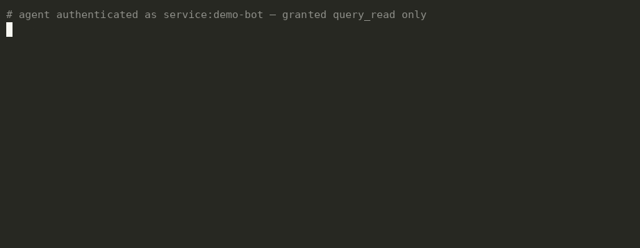

<p align="center">
  
</p>

<h1 align="center">db-mcp-gateway</h1>

<p align="center"><strong>Your AI agent needs to read the production database. The connection string is the one thing you cannot hand it.</strong></p>

<div align="center">

[](#ai-maintained)
[](https://github.com/developerz-ai/db-mcp-gateway/actions/workflows/ci.yml)
[](https://github.com/developerz-ai/db-mcp-gateway/releases/latest)
[](https://github.com/developerz-ai/db-mcp-gateway/pkgs/container/db-mcp-gateway)
[](https://www.rust-lang.org)
[](https://github.com/developerz-ai/db-mcp-gateway/stargazers)
[](LICENSE)

</div>

Give an agent a database URL and that credential now lives on a laptop, in a
config file, in shell history, and in whatever the agent decides to echo back.
Rotating it means finding every copy. And every query it runs is attributed to
nobody.

**db-mcp-gateway holds the credential instead.** It is a self-hosted MCP server
your team deploys once. Developers point their agent at one URL. The gateway
authenticates them through the SSO you already run, checks each query against
permissions reviewed by pull request, and commits an append-only audit row
before any result goes back.

## The denial is the product

<p align="center">
  
</p>

## Install

**v2.3.1 — stable, in production use.** Upgrading from 1.x: [`website/docs/deployment/upgrading-to-2.md`](website/docs/deployment/upgrading-to-2.md). One image, one YAML file, and one Postgres for the gateway's own state:

```bash
docker pull ghcr.io/developerz-ai/db-mcp-gateway:2.3.1
```

Public on GHCR, no auth needed to pull. Multi-arch (`linux/amd64`,
`linux/arm64`), built reproducibly from a `v*` git tag. `:latest` tracks the
newest release; pin the version in production. Compatibility policy in
[`website/docs/deployment/releasing.md`](website/docs/deployment/releasing.md),
deployment in [`website/docs/deployment/quickstart.md`](website/docs/deployment/quickstart.md).

Client side, that is the whole setup:

```bash
claude mcp add --transport http db-gateway --scope project https://db.internal.acme.com/mcp
```

The first call triggers SSO in a real browser — no embedded webview, no token
pasting. Walk through it end to end in
[`website/docs/usage/first-query.md`](website/docs/usage/first-query.md), or use
another MCP client via
[`website/docs/usage/other-agents.md`](website/docs/usage/other-agents.md).

---

## Three pillars

| Pillar | What it means |
|---|---|
| **Credentials never leave the gateway** | No DB URL on a laptop, ever. No tool returns one. No log line contains one. |
| **Identity end-to-end** | Every query traces SSO user → group → grant → audit row. |
| **Config-as-code** | Permissions live in YAML, reviewed by PR. No in-band admin UI, by design. |

---

## Supported databases

"MySQL" means two unrelated things here, so both are stated once, in one table.
**Query targets** are what an agent can read through the gateway. The
**permissions store** is where the gateway keeps its own grant metadata — an
agent never touches it.

| | PostgreSQL | YugabyteDB (YSQL) | MongoDB | Redis / Dragonfly / Valkey | MySQL | MSSQL |
|---|---|---|---|---|---|---|
| **Query target** — agents can query it | yes | yes, as `kind: postgres` — [CI-tested](website/docs/usage/multi-db.md#yugabytedb) | yes, read-only | yes, read-only (`kind: redis`; Redis + Dragonfly CI-tested) | no — [rejected at boot](website/docs/usage/multi-db.md) | no — rejected at boot |
| **Permissions store** — gateway's own state | yes | not tested | no, by design | no, by design | resolver path only, [no admin API](website/docs/deployment/admin-api.md) | no |

A `server.kind` of `mysql` or `mssql` refuses to start rather than booting
clean and failing every query, so a wrong config is caught at deploy time and
not by a user. MySQL and MSSQL query adapters are on the roadmap. Writes
(`query_write`) exist on Postgres-protocol targets only; Mongo and Redis stay
read-only whatever the grant, and Redis key scoping is the ACL user's job
([multi-db](website/docs/usage/multi-db.md)).

**Performance:** measured numbers are published in
[website/docs/benchmarks.md](website/docs/benchmarks.md), with the raw run
evidence committed under [`benchmarks/results/`](benchmarks/results/) — and
the harness to [measure it yourself](website/docs/benchmarks.md) on your own
hardware.

---

## What it does

- **MCP tool surface** — `list_servers`, `list_databases`, `describe_schema`, `sample_table`, `run_query`, `explain`, `get_query_history`, `table_stats`, `db_activity`, `cancel_query`, `whoami`. `run_query` takes SQL on PostgreSQL and YugabyteDB, a JSON command document on MongoDB, and a JSON argv array (`["HGETALL","user:1"]`) on Redis and Dragonfly.
- **OIDC SSO** — Any OIDC-compliant identity provider (e.g. Okta, Google Workspace, Entra, Authentik, Keycloak). Browser-flow login from the agent.
- **Read-only by default, writes opt-in per grant** — per-database least-privilege roles; a `query_write` grant permits data writes (INSERT/UPDATE/DELETE), never schema changes. Statement timeouts and row caps enforced at the DB *and* gateway layer.
- **Permissions in YAML** — group × server × database × action, with per-grant constraints (`require_reason`, `row_limit`, `statement_timeout_ms`). Table and schema scoping is the target-DB role's job, not a grant's. Reviewed by PR, with the full change history git already gives you.
- **Synchronous audit log** — user, SQL, reason, row count, duration, outcome. The write commits *before* the response is sent; if it fails, the request fails. Retained in the gateway's Postgres with a configurable TTL and an hourly pruner, with optional `stdout`/`syslog` stream sinks for feeding an existing log pipeline or SIEM. Archive to object storage and OTLP streaming are [roadmap Phase 4](website/docs/initial-idea/11-roadmap.md), not shipped.
- **Boring deployment** — `docker pull`, one YAML file, and one Postgres for the gateway's own state. The databases your agents query are your existing ones; the [local quickstart](website/docs/deployment/quickstart.md#run-it-locally) stands up a throwaway target too, so you can try it end to end without pointing at anything real. No agent runtime, no query builder, no credential vault to operate.

[Complete feature documentation →](website/docs/features.md)

---

## Who it's for

| If you are… | What you get |
|---|---|
| **Platform / SRE** | Agent database access without credential exposure, and one place to revoke it |
| **A backend developer** | Production queries for debugging with no password on your laptop, every one attributed to you |
| **Data / analytics engineers** | Agent-assisted access to supported targets through one interface, with resource limits already enforced |
| **Security / compliance** | Per-query SSO attribution, enforced reason logging, and an audit trail you did not have to build |

[Detailed use cases →](website/docs/use-cases.md)

---

## How it works

```
┌─────────┐    MCP/HTTPS    ┌──────────────┐ pg/mongo/redis┌──────────┐
│ agent   │ ──────────────▶ │   gateway    │ ────────────▶ │ target   │
│ (Claude │   bearer: jwt   │              │  ro role per  │  DBs     │
│  Code)  │ ◀────────────── │  authz+audit │ ◀──────────── │          │
└─────────┘   tool result   └──────┬───────┘   result rows └──────────┘
                                   │
                                   ▼
                            ┌──────────────┐
                            │ state DB     │
                            │ (sessions +  │
                            │  audit log)  │
                            └──────────────┘
```

---

## Docs

| If you're… | Read |
|---|---|
| Trying to understand what this is | [`website/docs/initial-idea/01-overview.md`](website/docs/initial-idea/01-overview.md) |
| A developer whose org already runs it | [`website/docs/usage/first-query.md`](website/docs/usage/first-query.md) (5-min walkthrough) → [`website/docs/usage/claude-code.md`](website/docs/usage/claude-code.md) (reference) |
| A platform/SRE deploying it | [`website/docs/deployment/quickstart.md`](website/docs/deployment/quickstart.md) → [IdP guides](website/docs/deployment/idp/okta.md), [target roles](website/docs/deployment/target-roles.md), [operations](website/docs/deployment/operations.md) |
| Adding it to a non-Claude MCP client | [`website/docs/usage/other-agents.md`](website/docs/usage/other-agents.md) |
| Cutting a release | [`website/docs/deployment/releasing.md`](website/docs/deployment/releasing.md) |
| Wondering what it *won't* do | [`website/docs/initial-idea/10-non-goals.md`](website/docs/initial-idea/10-non-goals.md) |
| Tracking what's built vs planned | [`website/docs/initial-idea/11-roadmap.md`](website/docs/initial-idea/11-roadmap.md) |
| Asking about performance | [`website/docs/benchmarks.md`](website/docs/benchmarks.md) |
| Comparing against alternatives | [`website/docs/comparison.md`](website/docs/comparison.md) |

---

## Built with

| Concern | Choice |
|---|---|
| Language | Rust (stable) |
| Async runtime | tokio |
| HTTP | axum |
| DB drivers | sqlx (Postgres, YugabyteDB YSQL), mongodb, redis (`tokio-rustls-comp`) |
| Config | serde + YAML, validated at boot |
| State store | Postgres (co-deployed) |
| Distribution | OCI image — `ghcr.io/developerz-ai/db-mcp-gateway` |

---

## AI-maintained

db-mcp-gateway is maintained by AI: by [developerz.ai](https://developerz.ai), the way a human maintainer looks after an open-source project. The agent works publicly as `developerz-ai[bot]` and marks every comment it posts as bot-made. Its policy is committed in [`.dz/maintainer/maintainer.yml`](.dz/maintainer/maintainer.yml), and [`CLAUDE.md`](CLAUDE.md) binds it: no policy line relaxes a non-negotiable.

| What arrives | What happens |
|---|---|
| an issue | triaged; asked for a reproduction when one is missing; a real bug is fixed and released |
| a pull request | reviewed (CodeRabbit and the developerz.ai reviewer), driven to green on `fmt`, `clippy`, `test` and `audit`, merged |
| a pull request on a security-review path (auth, authz, audit, exec, tools, state, secrets) | labelled `security review required`, merged only once the mandatory security pass has nothing open |
| Dependabot | driven to green and merged; every bump waits 14 days after upstream publishes it (security updates excepted) |
| an outside change to CI, release or publish automation | declined: members maintain the pipeline that publishes the image |
| a change that weakens a non-negotiable | declined with the rule quoted |
| a breaking change (tool surface, error codes, config schema, audit shape) or a new feature | a human decides: the team still designs and builds features, humans and AI together |

Scheduled checkups, briefs in [`.dz/schedules/`](.dz/schedules/): weekly `release-due` judges whether a release is needed, daily `security-release` ships a confirmed security fix off-cycle, weekly `health` catches the failures nothing announces, and monthly `improve` lands at most three small, evidenced improvements.

## Star history

<a href="https://star-history.com/#developerz-ai/db-mcp-gateway&Date">
  <picture>
    <source media="(prefers-color-scheme: dark)" srcset="https://api.star-history.com/svg?repos=developerz-ai/db-mcp-gateway&type=Date&theme=dark">
    
  </picture>
</a>

## License

MIT. See [`LICENSE`](LICENSE).
